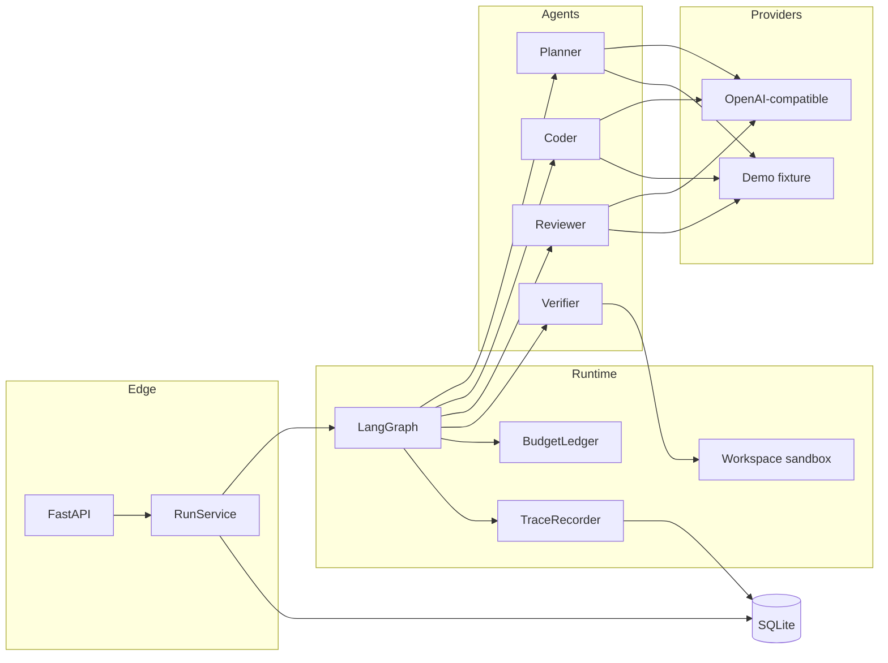
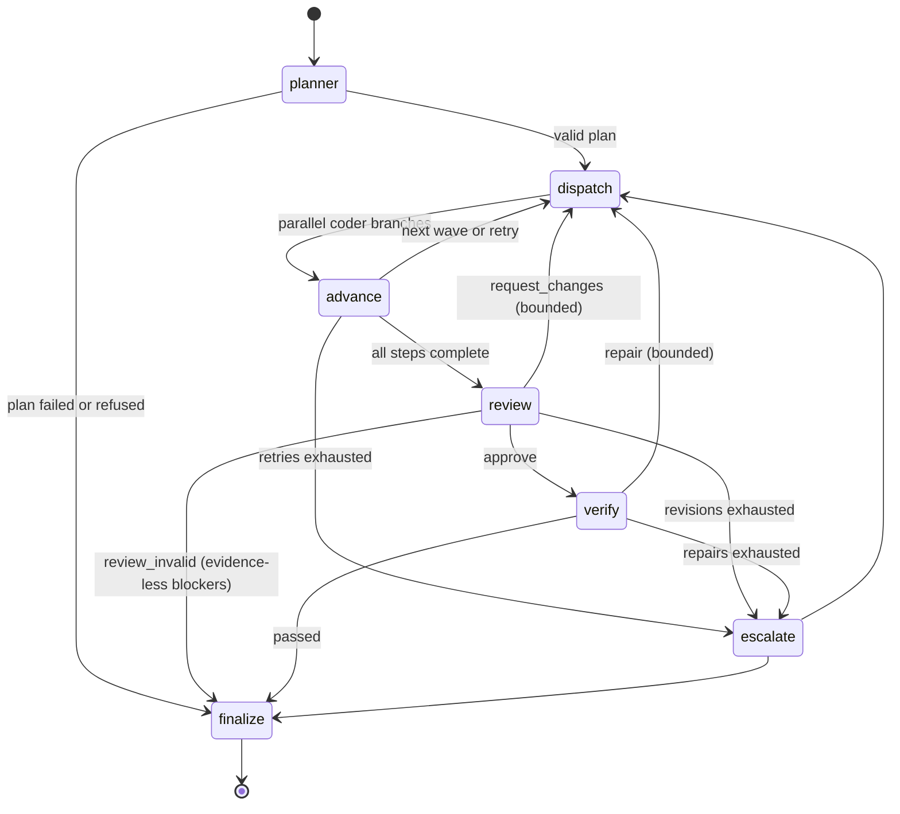
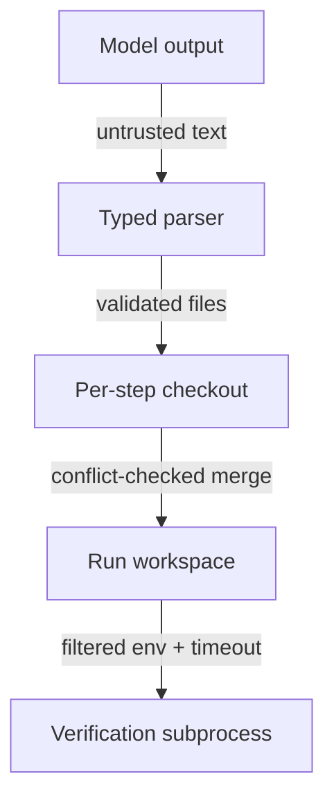
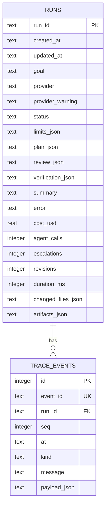
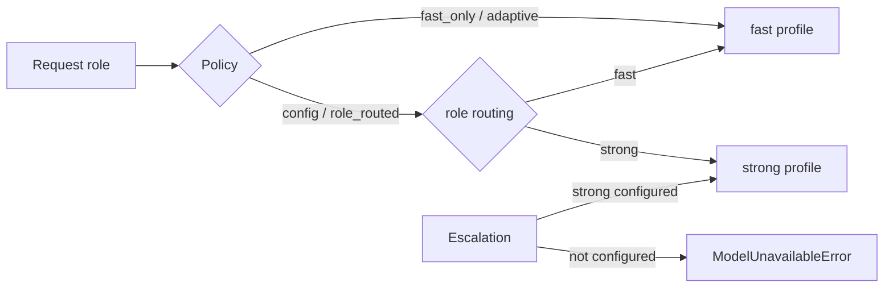

# Architecture

## Components



`RunService` resolves the provider, clamps the requested limits against the process ceiling, creates a run record, and hands execution to the graph. The graph is compiled per run and closes over a `RunRuntime` that owns the provider, ledger, trace recorder, and temporary workspace.

## Shared state

`SwarmState` is a `TypedDict`. Channels that parallel branches write carry a reducer; every other channel has exactly one serial writer. This makes concurrent fan-out safe by construction.

| Channel | Writer | Reducer |
| --- | --- | --- |
| `goal`, `limits`, `provider`, `started_at` | service | — |
| `plan`, `model_tier`, `workspace` | planner / escalate / advance | — |
| `completed_steps`, `merged_coded`, `merged_changes` | advance | — |
| `review`, `pending_review_steps`, `revisions` | review | — |
| `verification`, `verification_attempts` | verify | — |
| `escalations`, `stage`, `status`, `error`, `summary` | serial nodes | — |
| `changes`, `coded_steps`, `failures`, `halt` | code_step / advance | list concat |
| `agent_invocations` | any agent call | list concat |
| `cost_usd`, `agent_calls` | any agent call | numeric add |
| `attempts` | code_step | per-key max |

A coding branch reports success on `coded_steps`, never on `completed_steps`. Only `advance` marks a step complete after merge validation, so a rejected conflict cannot be mistaken for success.

## Graph



| Source | Condition | Target |
| --- | --- | --- |
| planner | plan exists and a step is ready | `Send` per ready step |
| planner | no plan, halted, or failed | finalize |
| advance | unresolved failure with attempts left | `Send` retry |
| advance | unresolved failure, escalation available | escalate |
| advance | ready steps remain | `Send` next wave |
| advance | steps remain but none are ready | finalize |
| advance | all steps complete | review |
| review | `approve` | verify |
| review | `request_changes` resting only on evidence-less blockers | finalize (`review_invalid`) |
| review | `request_changes`, revisions left | `Send` revision |
| review | `request_changes`, no revisions, escalation available | escalate |
| verify | passed | finalize |
| verify | failed, repair rounds left | `Send` repair |
| verify | failed, escalation available | escalate |
| escalate | review, failure, or verification work remains | `Send` the corresponding batch |

Steps are dispatched only when all of `depends_on` are complete, so every `Send` batch is mutually independent. Revision and repair batches use the earliest plan wave that intersects the target steps for the same reason.

## Failure semantics

| Situation | Result |
| --- | --- |
| Planner cannot produce a valid typed plan | `failed`, no coding starts |
| Coder returns invalid JSON | Attempt fails; bounded retry, then escalation |
| Coder answers for a different step | Attempt fails; treated as invalid output |
| Two independent steps write the same file | Both writes rejected as a conflict; retry/escalation or fail |
| Reviewer requests changes | Revision rounds up to `max_revisions` |
| Reviewer rejects only with evidence-less blockers | `review_invalid` (terminal): no revision, no escalation, diagnostic verification attached; never an approval |
| Reviewer still rejects after the limit | `completed_with_findings` with a diagnostic verification result; the changes are not approved |
| Verification fails | Repair rounds up to `max_retries`, then fail |
| Ledger refuses a call | `budget_exceeded` (USD) or `limit_exceeded` (call count) |
| Wall-clock limit reached before, during, or between calls or verification | `timed_out`; an in-flight model call is abandoned and verification is killed at the deadline |
| Cancelled via `POST /api/runs/{id}/cancel` or at server shutdown | `cancelled`; the verification process tree is killed and the progress so far is kept |
| Server stopped while a run was queued or running | `failed` with an "interrupted" error, applied at the next startup |
| Unexpected graph exception | `failed`, with the exception recorded in the trace |

## Run lifecycle

- **Progress.** The run record is saved after planning, after each merge, after
  review, and after verification. A client polling a live run sees the plan,
  call count, cost, changed files, review, and verification as they happen,
  not only at the end.
- **Deadline.** The ledger refuses calls that would start after
  `max_wall_seconds`. `AgentRunner` also caps each provider call at the
  remaining time, and verification's timeout is capped the same way.
- **Off the event loop.** Verification runs on a worker thread
  (`asyncio.to_thread`), so a long test run does not freeze the API.
- **Cancellation.** `RunService.cancel` cancels the orchestration task and kills
  the verification process. On shutdown, runs get a short grace period and are
  then cancelled. On startup, `RunStore.recover_interrupted` closes runs that a
  stopped process left `queued` or `running`. This assumes one API process per
  database; a durable job queue replaces it in M3.
- **Sequential coding.** With `limits.parallel_coding = false`, waves are still
  dispatched as batches, so routing and revision rounds are unchanged, but
  their coding calls run one at a time.
- **Revisions** receive every actionable finding for each revised step. A
  finding without a known `step_id` goes to every revised step. Blockers the
  evidence guard found unsupported are withheld and listed in the `revision`
  event.
- **Snapshot truncation** emits one `warning` event, and the run summary says
  the agents saw a partial workspace.

## Review evidence guard

A small local model repeatedly rejected correct code with blockers that only
restated the acceptance criteria (runs `run_478959ca3d86`, `run_9038fdabb1b9`).
`app/review_evidence.py` checks the **shape** of each blocker's evidence before a
rejection may dispatch a revision. It cannot judge whether a claim is true.

A blocker is supported when its `message` has all of:

| Evidence | Accepted forms |
| --- | --- |
| Code reference | `line N`, `file.py:N`, or a backticked expression (`sorted(x)`, `a == b`, `n = 0`); a bare path or name does not count |
| Acceptance criterion | a criterion of 15+ characters appearing verbatim, an exact quote of any criterion, or a quoted excerpt of 3+ words |
| Relevant file | `file` is absent or names a workspace file (`./` and `\` are normalised) |
| Expected/actual | required only for runtime claims (`returns`, `fails`, `raises`, …): `expected … actual`, `returns X instead of Y`, `should return X but returns Y`, `expected X but got Y` |

Quoted criterion text is not itself treated as a runtime claim.

Routing (`Orchestrator._review`):

- A `request_changes` review whose blockers are all unsupported, with no
  supported finding, ends the run as `review_invalid`. A `failure` trace event
  lists each blocker and its missing evidence.
- `review_invalid` is terminal for now. It is not an approval, does not count as
  a revision, never escalates, and keeps `verdict = request_changes`.
- Verification stays independent. A diagnostic verification is attached for
  ground truth and never changes the status.
- Only blockers are validated. Major/minor/nit findings, and a rejection with no
  findings, follow the normal revision path.

Known limits: a fabricated finding with the right shape passes, and a genuine
defect described without evidence ends the run without a repair round.

## Event contract

Every trace event is `{event_id, run_id, seq, at, kind, message, payload}`.
`seq` starts at 1 and increases by one per event within a run. A client
polls `GET /api/runs/{id}/events?after_seq=<last_seq>` to receive only new
events.

Each payload is validated on emit against the model for its `kind` in
`app/events.py`. Unknown fields are rejected, and the models are published
in OpenAPI under `TraceEventPayloads`.

| Kind | Meaning |
| --- | --- |
| `run_started` / `run_finished` | Run boundaries. `run_finished.status` is the terminal status |
| `routing_decision` | Discriminated by `decision`: `plan` (planner dispatched), `plan_accepted` / `plan_seeded` (the validated `plan` with `depends_on`, plus `waves`), `dispatch_coding` (steps queued, `parallel`, `mode`), `merge_wave` (accepted and rejected steps) |
| `agent_started` → `agent_invocation` | One model call: started just before the provider call, finished with tokens, latency, and output summary. Paired by `invocation_id`; every retry attempt is its own pair |
| `verification_started` → `verification` | The deterministic test runner (`runner: deterministic_subprocess`, never an agent). Paired by `verification_id`; `diagnostic: true` for evidence-only runs after a rejected review |
| `failure` | Always `error`; `error_class`, `role`, `step_id` and `attempt` where they apply. Orchestration failures name no agent |
| `revision`, `retry` (`scope`: `call` or `steps`), `repair`, `escalation`, `budget`, `provider`, `warning` | Loop, limit and diagnostic events |

**Dispatched vs running.** A step is dispatched in `routing_decision`, but
it is running only between its `agent_started` and `agent_invocation`. With
`parallel_coding = false`, a wave is dispatched together and its steps start
one at a time. The orchestrator's control nodes (`advance`, `escalate`,
`finalize`) never emit agent lifecycle events.

## Trust boundaries



1. **Model output is untrusted.** It is parsed into a Pydantic model; paths are normalized and rejected if absolute, traversing, or too long. File count and size per step are capped.
2. **Coding branches are isolated.** Each step gets its own checkout under the run's temp root, and the checkout is destroyed after the branch returns. The canonical workspace changes only in `advance`.
3. **Verification is contained, not sandboxed.** The subprocess inherits only an allow-listed environment (`PATH`, `SYSTEMROOT`, `TEMP`, `PYTHONPATH`, …), so provider credentials cannot leak into test code. It runs with a wall-clock timeout. There is no filesystem namespace, cgroup, or network block.

## Persistence



Events are appended as they happen, so the dashboard can follow a live run. `run_id` is a foreign key; the service persists the run row before execution begins.

## Provider abstraction

`Provider` is a protocol with one async method:

```python
class Provider(Protocol):
    name: str
    async def complete(self, request: ModelRequest) -> ModelResponse: ...
```

Providers report text and token usage. The runtime owns pricing (`Settings.rates_for`), reservations, and settlement. Two implementations ship:

- `DemoProvider` — deterministic, role-aware, scripted for the sample workspace.
- `OpenAICompatibleProvider` — generic chat-completions transport with a timeout and typed errors.

SwarmOS makes no assumption that a hosted assistant exposes its internal models. If no endpoint is configured, runs use the fixture and say so in the run record, the trace, and the UI.

## Model selection, errors, and safety

An API key is optional; only the base URL and fast model id are required. Requests
carry `temperature: 0.1` and, when enabled, `response_format: json_object`, which is
downgraded once if the server rejects it.

`RunRuntime.selection_for_role(role)` resolves a `ModelProfile` (`fast` or `strong`)
under the active policy. `selection_for_tier("strong")` raises
`ModelUnavailableError` rather than silently returning the fast model, so an
unavailable escalation is recorded as unavailable.



`ProviderError` carries `category`, `retryable`, `status_code`, and optionally
`retry_after_seconds`. The call runner retries only `rate_limit`, `timeout`,
`connection`, and `server`, with exponential backoff. `auth`, `bad_request`,
`not_found`, and `invalid_response` fail fast. Invalid structured output is retried
with a repair note containing the parser error.

The Verification Agent runs the configured command inside the run's temporary
workspace. Execution is gated by `SWARMOS_EXECUTION_ENABLED`, restricted by a binary
allowlist (no shell), bounded by a timeout that kills the process tree, and given a
filtered environment so provider credentials are not inherited. This is containment,
not a sandbox: there is no kernel isolation or network block. See
[safety.md](safety.md).

Runs also record `provider_kind`, `model_policy`, `models_by_role`,
`monetary_enforced`, and `usage_available`. Existing databases are migrated on open
by adding missing columns with defaults; no data is rewritten.

## Extension points

- **New agent role:** subclass `Agent[InputT, OutputT]`, add a node, and route to it. Typed inputs keep prompts and parsing together.
- **New provider:** implement `Provider`, register it in `resolve_provider`.
- **Different verification:** change `SWARMOS_VERIFY_COMMAND`; the verifier parses `N passed` / `N failed` and treats an empty suite as not passing.
- **Durable execution:** the graph is checkpoint-ready; adding a LangGraph checkpointer and a worker queue is the next step.