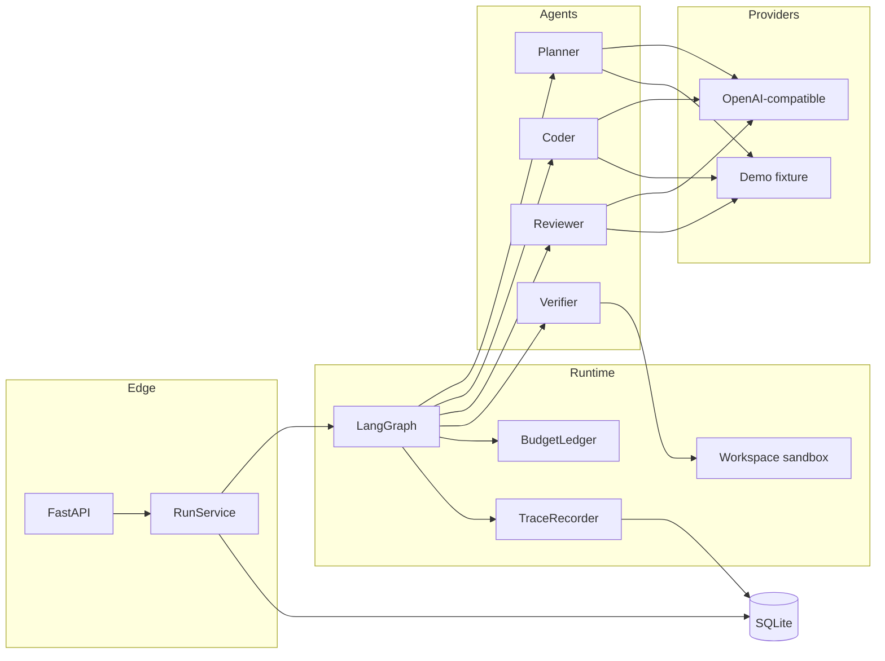
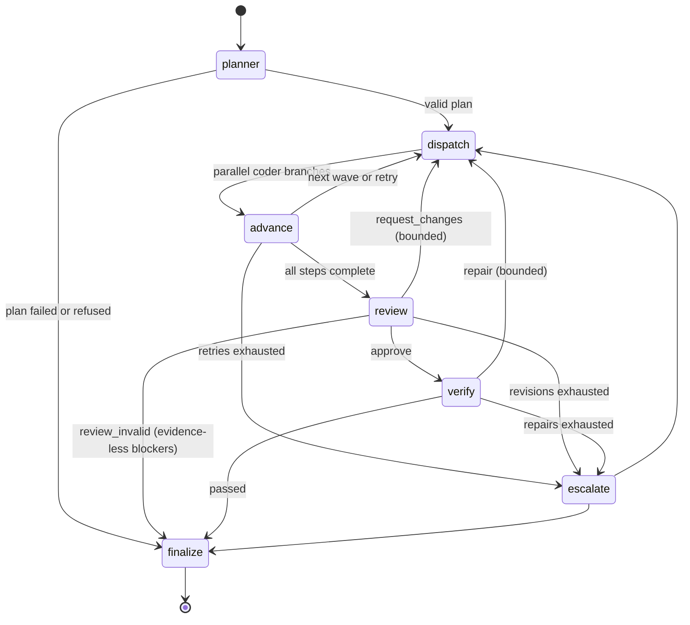
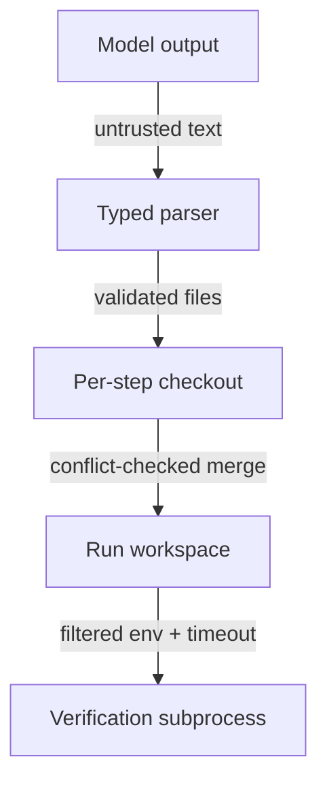
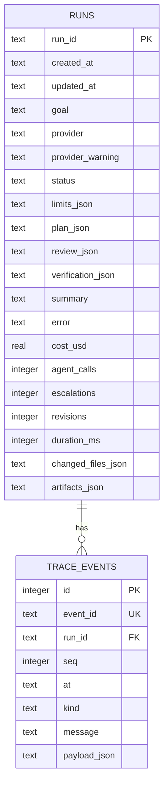
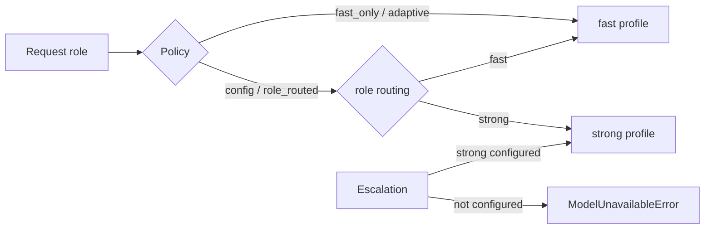

# Architecture

## Components



`RunService` resolves the provider, clamps the requested limits against the process ceiling, creates a run record, and hands execution to the graph. The graph is compiled per run and closes over a `RunRuntime` that owns the provider, ledger, trace recorder, and temporary workspace.

## Shared state

`SwarmState` is a `TypedDict`. Channels that parallel branches write carry a reducer; every other channel has exactly one serial writer. This makes concurrent fan-out safe by construction.

| Channel | Writer | Reducer |
| --- | --- | --- |
| `goal`, `limits`, `provider`, `started_at` | service | — |
| `plan`, `model_tier`, `workspace` | planner / escalate / advance | — |
| `completed_steps`, `merged_coded`, `merged_changes` | advance | — |
| `review`, `pending_review_steps`, `revisions` | review | — |
| `verification`, `verification_attempts` | verify | — |
| `escalations`, `stage`, `status`, `error`, `summary` | serial nodes | — |
| `changes`, `coded_steps`, `failures`, `halt` | code_step / advance | list concat |
| `agent_invocations` | any agent call | list concat |
| `cost_usd`, `agent_calls` | any agent call | numeric add |
| `attempts` | code_step | per-key max |

A coding branch reports success on `coded_steps`, never on `completed_steps`. Only `advance` marks a step complete after merge validation, so a rejected conflict cannot be mistaken for success.

## Graph



| Source | Condition | Target |
| --- | --- | --- |
| planner | plan exists and a step is ready | `Send` per ready step |
| planner | no plan, halted, or failed | finalize |
| advance | unresolved failure with attempts left | `Send` retry |
| advance | unresolved failure, escalation available | escalate |
| advance | ready steps remain | `Send` next wave |
| advance | steps remain but none are ready | finalize |
| advance | all steps complete | review |
| review | `approve` | verify |
| review | `request_changes` resting only on evidence-less blockers | finalize (`review_invalid`) |
| review | `request_changes`, revisions left | `Send` revision |
| review | `request_changes`, no revisions, escalation available | escalate |
| verify | passed | finalize |
| verify | failed, repair rounds left | `Send` repair |
| verify | failed, escalation available | escalate |
| escalate | review, failure, or verification work remains | `Send` the corresponding batch |

Steps are dispatched only when all of `depends_on` are complete, so every `Send` batch is mutually independent. Revision and repair batches use the earliest plan wave that intersects the target steps for the same reason.

## Failure semantics

| Situation | Result |
| --- | --- |
| Planner cannot produce a valid typed plan | `failed`, no coding starts |
| Coder returns invalid JSON | Attempt fails; bounded retry, then escalation |
| Coder answers for a different step | Attempt fails; treated as invalid output |
| Two independent steps write the same file | Both writes rejected as a conflict; retry/escalation or fail |
| Reviewer requests changes | Revision rounds up to `max_revisions` |
| Reviewer rejects only with evidence-less blockers | `review_invalid` (terminal): no revision, no escalation, diagnostic verification attached; never an approval |
| Reviewer still rejects after the limit | `completed_with_findings` with a diagnostic verification result; the changes are not approved |
| Verification fails | Repair rounds up to `max_retries`, then fail |
| Ledger refuses a call | `budget_exceeded` (USD) or `limit_exceeded` (call count) |
| Wall-clock limit reached before, during, or between calls or verification | `timed_out`; an in-flight model call is abandoned and verification is killed at the deadline |
| Cancelled via `POST /api/runs/{id}/cancel` or at server shutdown | `cancelled`; the verification process tree is killed and the progress so far is kept |
| Server stopped while a run was queued or running | `failed` with an "interrupted" error, applied at the next startup |
| Unexpected graph exception | `failed`, with the exception recorded in the trace |

## Run lifecycle

- **Progress.** The run record is saved after planning, after each merge, after
  review, and after verification. A client polling a live run sees the plan,
  call count, cost, changed files, review, and verification as they happen,
  not only at the end.
- **Deadline.** The ledger refuses calls that would start after
  `max_wall_seconds`. `AgentRunner` also caps each provider call at the
  remaining time, and verification's timeout is capped the same way.
- **Off the event loop.** Verification runs on a worker thread
  (`asyncio.to_thread`), so a long test run does not freeze the API.
- **Cancellation.** `RunService.cancel` cancels the orchestration task and kills
  the verification process. On shutdown, runs get a short grace period and are
  then cancelled. On startup, `RunStore.recover_interrupted` closes runs that a
  stopped process left `queued` or `running`. This assumes one API process per
  database; a durable job queue replaces it in M3.
- **Sequential coding.** With `limits.parallel_coding = false`, waves are still
  dispatched as batches, so routing and revision rounds are unchanged, but
  their coding calls run one at a time.
- **Revisions** receive every actionable finding for each revised step. A
  finding without a known `step_id` goes to every revised step. Blockers the
  evidence guard found unsupported are withheld and listed in the `revision`
  event.
- **Snapshot truncation** emits one `warning` event, and the run summary says
  the agents saw a partial workspace.

## Review evidence guard

A small local model repeatedly rejected correct code with blockers that only
restated the acceptance criteria (runs `run_478959ca3d86`, `run_9038fdabb1b9`).
`app/review_evidence.py` checks the **shape** of each blocker's evidence before a
rejection may dispatch a revision. It cannot judge whether a claim is true.

A blocker is supported when its `message` has all of:

| Evidence | Accepted forms |
| --- | --- |
| Code reference | `line N`, `file.py:N`, or a backticked expression (`sorted(x)`, `a == b`, `n = 0`); a bare path or name does not count |
| Acceptance criterion | a criterion of 15+ characters appearing verbatim, an exact quote of any criterion, or a quoted excerpt of 3+ words |
| Relevant file | `file` is absent or names a workspace file (`./` and `\` are normalised) |
| Expected/actual | required only for runtime claims (`returns`, `fails`, `raises`, …): `expected … actual`, `returns X instead of Y`, `should return X but returns Y`, `expected X but got Y` |

Quoted criterion text is not itself treated as a runtime claim.

Routing (`Orchestrator._review`):

- A `request_changes` review whose blockers are all unsupported, with no
  supported finding, ends the run as `review_invalid`. A `failure` trace event
  lists each blocker and its missing evidence.
- `review_invalid` is terminal for now. It is not an approval, does not count as
  a revision, never escalates, and keeps `verdict = request_changes`.
- Verification stays independent. A diagnostic verification is attached for
  ground truth and never changes the status.
- Only blockers are validated. Major/minor/nit findings, and a rejection with no
  findings, follow the normal revision path.

Known limits: a fabricated finding with the right shape passes, and a genuine
defect described without evidence ends the run without a repair round.

## Event contract

Every trace event is `{event_id, run_id, seq, at, kind, message, payload}`.
`seq` starts at 1 and increases by one per event within a run. A client
follows a live run over `GET /api/runs/{id}/stream` (see *Live streaming*),
or polls `GET /api/runs/{id}/events?after_seq=<last_seq>` to receive only
new events.

Each payload is validated on emit against the model for its `kind` in
`app/events.py`. Unknown fields are rejected, and the models are published
in OpenAPI under `TraceEventPayloads`.

| Kind | Meaning |
| --- | --- |
| `run_started` / `run_finished` | Run boundaries. `run_finished.status` is the terminal status |
| `routing_decision` | Discriminated by `decision`: `plan` (planner dispatched), `plan_accepted` / `plan_seeded` (the validated `plan` with `depends_on`, plus `waves`), `dispatch_coding` (steps queued, `parallel`, `mode`), `merge_wave` (accepted and rejected steps) |
| `agent_started` → `agent_invocation` | One model call: started just before the provider call, finished with tokens, latency, and output summary. Paired by `invocation_id`; every retry attempt is its own pair |
| `verification_started` → `verification` | The deterministic test runner (`runner: deterministic_subprocess`, never an agent). Paired by `verification_id`; `diagnostic: true` for evidence-only runs after a rejected review |
| `failure` | Always `error`; `error_class`, `role`, `step_id` and `attempt` where they apply. Orchestration failures name no agent |
| `revision`, `retry` (`scope`: `call` or `steps`), `repair`, `escalation`, `budget`, `provider`, `warning` | Loop, limit and diagnostic events |

**Dispatched vs running.** A step is dispatched in `routing_decision`, but
it is running only between its `agent_started` and `agent_invocation`. With
`parallel_coding = false`, a wave is dispatched together and its steps start
one at a time. The orchestrator's control nodes (`advance`, `escalate`,
`finalize`) never emit agent lifecycle events.

## Frontend execution model

`frontend/src/domain/execution/` turns a run's trace into a normalised
execution state that every view (timeline, 2D graph, 3D scene) renders. It
is pure TypeScript. Its only outside imports are types from the generated
API contract; it uses no React, store, DOM, or clock.

| Module | Role |
| --- | --- |
| `events.ts` | The only compatibility boundary: maps any trace event (pre-M3.0, current, or an unknown future kind) to one `NormalizedEvent` union |
| `model.ts` | `ExecutionState`: agents (planner, coder, reviewer), the deterministic verification runner, orchestrator operations, the plan with waves and dependencies, review rounds, budget, failures, and an integrity report |
| `reducer.ts` | `reduce(state, event)`: pure, seq-ordered, idempotent for duplicates, rebuilds on late events |
| `replay.ts` | `replay(events, { untilSeq })`, `createReplay` (memoised, scrubbable frames), and `createStateReplay` (the same frames over a state's own log, keeping shared frames as a live state grows) |

Rules the reducer keeps:

- A dispatched step is not running. A call is running only between
  `agent_started` and its completion. Traces recorded before lifecycle
  events never show a call in progress.
- `run_finished` closes open work as `interrupted`, never as succeeded.
- Dependencies come from the plan event, else the stored record, else stay
  unknown. They are never inferred from step order.
- `null` means "the trace does not establish this": no invented durations,
  token counts, or outcomes.

Fixtures are recorded from the real backend by
`scripts/record_trace_fixtures.py`.

## Live streaming

`GET /api/runs/{run_id}/stream` sends a run's persisted trace as
Server-Sent Events, live while the run executes, then closes. SQLite stays
the only event store: the stream reads exactly what `/events` returns.

```text
retry: 2000                       reconnect delay hint
id: 7                             one message per event, id = its seq
event: trace
data: {"event_id": ..., "seq": 7, "kind": "agent_started", ...}

: keepalive                       comment line while idle, never an event

event: end                        once the run is terminal and every event was sent
data: {"run_id": ..., "status": "completed", "last_seq": 17}
```

**Cursor rules.** `after_seq` (query) and `Last-Event-ID` (header, which a
browser's EventSource sends when it reconnects) both mean "I have every
event up to this seq". The stream starts after the **greater** of the two;
absent means 0. A malformed `Last-Event-ID` is a `400`, a malformed
`after_seq` a `422`. Events go out in ascending `seq` with their own `seq`
as the id, so a client resuming from its last id never receives an earlier
event as a new one.

**Why no event is lost.**

- *Connecting.* The stream reads the store from the cursor, so events
  recorded between a client reading its cursor and connecting are sent.
- *While open.* `RunStore` calls its listeners after each commit; a broker
  wakes the streams watching that run. Notifications carry no data: a
  stream subscribes before its first read, clears its wake flag before
  each read, re-reads after its cursor, and then waits. A commit during a
  read or while sending leaves the flag set, so the next wait returns at
  once. A missed wake-up costs at most a heartbeat; an event is never
  skipped.
- *Ending.* The status is read before each drain, and every terminal path
  writes its last event before (or with) the terminal status, so a terminal
  status seen before a drain means the drain was complete; only then is
  `end` sent.

**Resources.** Memory is one flag per open stream; events are read in
batches of 200 and written with back-pressure, so a slow client holds back
only its own stream. A stream closes when the client disconnects, at `end`,
or after `SWARMOS_STREAM_MAX_SECONDS` (the client resumes from its cursor).
The public demo caps open streams per client (4) and in total (40), the
`SWARMOS_API_TOKEN` check applies, and the endpoint creates nothing and
accepts no inputs beyond the cursor.

**Frontend transport** (`frontend/src/api/`). One connection per run per
QueryClient (`liveConnection.ts`), shared by every view of the run, reads
the stream with `fetch` (`stream.ts`, `sse.ts`) and folds each chunk of
events through the execution reducer into the same query-cache entry that
polling writes: there is no second state. It resumes after the reduced
state's `lastSeq`, so overlaps are no-ops.

| State | Meaning |
| --- | --- |
| connecting / connected | The stream is opening / open |
| reconnecting | Dropped: retried at once if it was healthy, else after 1, 2 and 4 s |
| polling | The stream is unavailable (repeated failures, `404`/`405`/`501`, or `429`): cursor polling every second, and the stream retried every 30 s (or after `Retry-After`) |
| disconnected | The browser is offline; reconnects when it is back |
| completed | `end` received: the record is refreshed, whose terminal status triggers one final `/events` fetch, and the stream is closed |

While the stream carries the run, neither the record nor the events are
polled. A poll folds its page onto the latest cached state, so it cannot
overwrite events the stream applied while the request was in flight.

**Playback.** Run Detail replays a run from its execution state's own log
(`createStateReplay`): play, pause, restart, step, scrub, 0.5× to 4×. The
position lives in the view store, so it survives switching between 2D and
3D, and every progress panel draws the same frame. Replay is derived only:
the live state keeps receiving events underneath and "back to live" shows
it again. Playback steps one event at a time and does not reproduce real
durations; elapsed time is shown only from recorded timestamps.

## Benchmark experiments

`app/benchmarks/` compares fixed configurations (arms) on fixed, versioned
suites. Every trial is an ordinary run through `RunService`; the trial row
links it. Experiments and trials are stored in two additive tables
(`benchmark_experiments`, `benchmark_trials`) in the same database.

**Ownership and recovery.** An experiment is run by one process (the API
server or a `bench` command); its status changes are conditional updates,
so a second runner cannot claim it or its trials. Ownership itself is not
recorded across processes: a process that dies leaves its experiment
`running`, and only one experiment may be active per database. The API
server closes such experiments as `interrupted` at startup (after run
recovery; nothing resumes). `swarmos bench --recover` does the same on
demand and is operator-only: it cannot tell whether another live process
still owns the experiment, so it must only be used when none does (if one
does, its trial in flight is recorded as an error, its run still completes
unmeasured, and it starts no further trials). There is no recovery
endpoint. A lease or heartbeat would remove this limitation; it
is not implemented.

**Public demo.** The benchmark API is read-only: only the catalog suite and
experiments on it are visible (others are indistinguishable from unknown
ones), creation and cancellation are `403`, host details are left out, and
free-text errors are redacted (the endpoint URL and key never appear, and
no URL at all in the public demo).

### Benchmark pages

`/benchmarks` and `/benchmarks/:experimentId` are lazy routes over one data
layer (`frontend/src/api/benchmarkQueries.ts`); no page fetches on its own.

| Query | Key | Refresh |
| --- | --- | --- |
| Suites, arms, caps, `can_create` | `["benchmarks","suites"]` | stale after 60 s |
| Experiment list (infinite) | `["benchmarks","experiments",{limit}]` | every 2 s while any loaded experiment is `queued` or `running` |
| One experiment | `["benchmarks","experiment",id]` | every 2 s while it is `queued` or `running` |

- **Paging.** The list follows the API's keyset cursor (`next_cursor`).
  Rows are deduplicated by id across pages. A refresh refetches every
  loaded page with cursors recomputed from the fresh pages, so loaded
  pages stay on screen and an experiment never appears twice.
- **Polling ends with the experiment.** Both intervals return `false` once
  every relevant experiment is terminal (`completed`, `partial`,
  `cancelled`, `failed`, `interrupted`); nothing polls a finished
  experiment. A failed refresh keeps the last data on screen and says the
  refresh failed.
- **Mutations.** Creation never retries automatically (mutations have
  `retry: false`). On success its response seeds the detail cache, so the
  new page renders without another request, and the lists are invalidated.
  The cancel hook invalidates the detail and the lists; no page offers
  cancellation yet.
- **Creation is the server's decision.** The form is mounted only when the
  suites response says `can_create`, offers only the server's suites,
  tasks, arms and caps, validates the trial count against `max_trials`,
  and reports 400/403/409/422/429/5xx as the server worded them. It is a
  convenience, not a guard: the API enforces every rule itself, and the
  public demo answers `403` whatever the client sends.
- **Metrics are displayed, never computed.** Rates, distributions, means,
  exclusions and identical-by-design groups come from the backend. A null
  value is shown as unknown with the backend's `null_reasons` entry (or
  its `*` reason), never as `0`; a rate is shown with its denominator
  ("50% (1 of 2)"). Task success (the run completed) and verification (the
  tests passed) are separate. Durations are formatted from recorded
  milliseconds; the only derived figure is an experiment's elapsed time,
  from its recorded start and finish. No chart is drawn yet.

## Trust boundaries



1. **Model output is untrusted.** It is parsed into a Pydantic model; paths are normalized and rejected if absolute, traversing, or too long. File count and size per step are capped.
2. **Coding branches are isolated.** Each step gets its own checkout under the run's temp root, and the checkout is destroyed after the branch returns. The canonical workspace changes only in `advance`.
3. **Verification is contained, not sandboxed.** The subprocess inherits only an allow-listed environment (`PATH`, `SYSTEMROOT`, `TEMP`, `PYTHONPATH`, …), so provider credentials cannot leak into test code. It runs with a wall-clock timeout. There is no filesystem namespace, cgroup, or network block.

## Persistence



Events are appended as they happen, so the dashboard can follow a live run. `run_id` is a foreign key; the service persists the run row before execution begins.

## Provider abstraction

`Provider` is a protocol with one async method:

```python
class Provider(Protocol):
    name: str
    async def complete(self, request: ModelRequest) -> ModelResponse: ...
```

Providers report text and token usage. The runtime owns pricing (`Settings.rates_for`), reservations, and settlement. Two implementations ship:

- `DemoProvider` — deterministic, role-aware, scripted for the sample workspace.
- `OpenAICompatibleProvider` — generic chat-completions transport with a timeout and typed errors.

SwarmOS makes no assumption that a hosted assistant exposes its internal models. If no endpoint is configured, runs use the fixture and say so in the run record, the trace, and the UI.

## Model selection, errors, and safety

An API key is optional; only the base URL and fast model id are required. Requests
carry `temperature: 0.1` and, when enabled, `response_format: json_object`, which is
downgraded once if the server rejects it.

`RunRuntime.selection_for_role(role)` resolves a `ModelProfile` (`fast` or `strong`)
under the active policy. `selection_for_tier("strong")` raises
`ModelUnavailableError` rather than silently returning the fast model, so an
unavailable escalation is recorded as unavailable.



`ProviderError` carries `category`, `retryable`, `status_code`, and optionally
`retry_after_seconds`. The call runner retries only `rate_limit`, `timeout`,
`connection`, and `server`, with exponential backoff. `auth`, `bad_request`,
`not_found`, and `invalid_response` fail fast. Invalid structured output is retried
with a repair note containing the parser error.

The Verification Agent runs the configured command inside the run's temporary
workspace. Execution is gated by `SWARMOS_EXECUTION_ENABLED`, restricted by a binary
allowlist (no shell), bounded by a timeout that kills the process tree, and given a
filtered environment so provider credentials are not inherited. This is containment,
not a sandbox: there is no kernel isolation or network block. See
[safety.md](safety.md).

Runs also record `provider_kind`, `model_policy`, `models_by_role`,
`monetary_enforced`, and `usage_available`. Existing databases are migrated on open
by adding missing columns with defaults; no data is rewritten.

## Extension points

- **New agent role:** subclass `Agent[InputT, OutputT]`, add a node, and route to it. Typed inputs keep prompts and parsing together.
- **New provider:** implement `Provider`, register it in `resolve_provider`.
- **Different verification:** change `SWARMOS_VERIFY_COMMAND`; the verifier parses `N passed` / `N failed` and treats an empty suite as not passing.
- **Durable execution:** the graph is checkpoint-ready; adding a LangGraph checkpointer and a worker queue is the next step.