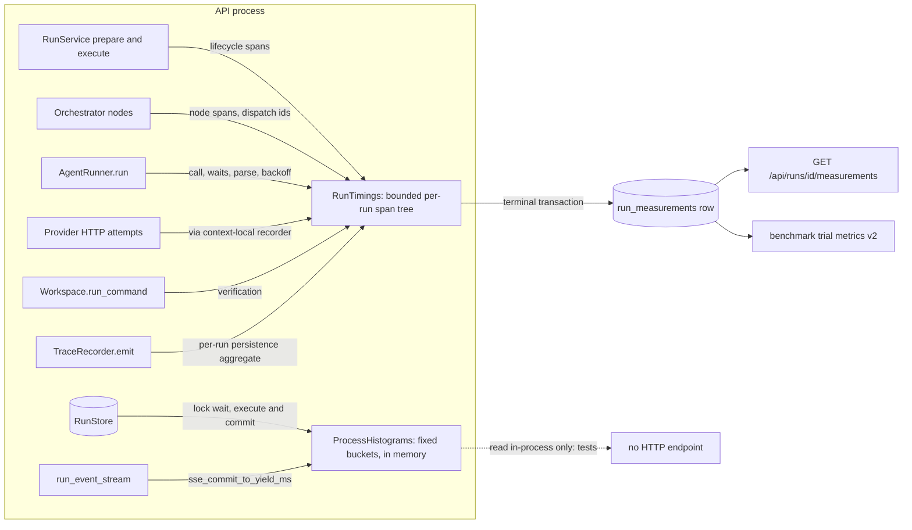

# M7.0 — Observability architecture proposal

Status: **revised proposal, after the first M7.0 review**. Nothing here is
implemented. No code, schema, dependency or database was changed to write
it.

Conventions used throughout:

- **Observed** statements describe code at commit `e533ea4` and cite the
  file and function or class. **Proposed** statements are design.
  **Assumption** marks something not yet verified by measurement.
- Durations are milliseconds unless stated. "Monotonic" means
  `time.perf_counter_ns()` deltas within one process.

### Review decisions incorporated

| Decision | Where |
| --- | --- |
| One excluded warm-up trial per arm and task | §8 |
| At least 20 **measured** trials per arm and task, after the warm-up and after exclusions | §4.4, §8 |
| Process histograms stay in memory, bounded; no `/api/ops/metrics` endpoint for now | §3, §6, §7.2 |
| The proposal lives in the repository; no external page | this file |
| `execution_ms` separate from `lifecycle_ms`; exact admission and execution boundaries | §3.2 |
| No overhead by subtraction: dependency-aware spans; coder wall time vs critical path | §3.3, §4.1 |
| Provider call, individual HTTP attempts (with count) and parsing measured separately | §3.4 |
| `sse_commit_to_yield_ms`, not "delivery latency" | §3.5, §4.1 |
| Crash and flush-failure behaviour; atomic terminal persistence evaluated | §5.2 |
| Bounded spans and payload; dropped-span reporting; overhead measurement | §3.6 |

---

## 1. Current architecture (observed)

### 1.1 Execution lifecycle

| Area | Observed behaviour | Where |
| --- | --- | --- |
| Admission | `prepare` validates the request, resolves the provider, and **commits the run row as `queued`**; `start` then creates the asyncio task. There is no queue: over capacity, the request is refused with 429 before any row exists | `RunService.prepare`, `RunService.start`, `RunService.check_capacity` (`app/service.py`); `create_run` (`app/main.py`) |
| Inline runs | `run_request` (local `wait=true`) calls `prepare` and awaits `execute` directly, without a task hop | `RunService.run_request` |
| Start | `execute` commits `running`, builds `RunRuntime` (ledger, trace recorder, temp workspace), seeds the workspace, then runs the orchestrator | `RunService.execute`; `RunRuntime.__init__`, `RunRuntime.seed_workspace` (`app/runtime/runtime.py`) |
| Graph | LangGraph `StateGraph` with nodes `planner`, `code_step`, `advance`, `review`, `verify`, `escalate`, `finalize`; routing by `_after_*` functions | `Orchestrator._build` (`app/orchestrator.py`) |
| Parallel waves | A wave is fanned out with LangGraph `Send` (one `code_step` per step), then joins in `advance`. With `parallel_coding` off, the same batch is dispatched but a `Semaphore(1)` serialises the coding calls | `Orchestrator._dispatch`, `_code_step`, `__init__` (`_coding_slot`) |
| Agent calls | `AgentRunner.run` reserves budget, emits `agent_started`, calls the provider under the run deadline, parses, emits `agent_invocation` | `AgentRunner.run`, `_complete_before_deadline` (`app/agents/runner.py`) |
| Retries | Planner and reviewer: call-level retries, `max_attempts = 1 + max_retries`; coder: one attempt per dispatch, step-level retries by re-dispatch | `Orchestrator._planner` (line ~305), `_code_step` (~366), `_review` (~566) |
| Verification | Runs on a worker thread (`asyncio.to_thread`) as a subprocess; under `restricted`, through the sandbox launcher | `Orchestrator._run_verifier`; `Workspace.run_command`, `Workspace._restricted_argv` (`app/runtime/workspace.py`) |
| Cancellation | Started runs: kill the verification process tree, cancel the task; the `CancelledError` branch emits `run_finished` and commits `cancelled`. Not yet started: `cancel` commits `cancelled` itself | `RunService.cancel`, `RunService.execute`; `Workspace.kill_active_process` |
| Terminal writes | The last event (`run_finished`; a `failure` event on the crash path) is appended in its own commit before the terminal `save_run` (another commit); the stream relies on that order | `Orchestrator._finalize` (`run_finished`), `RunService.execute` (cancel and crash branches, terminal `save_run`); module docstring of `app/streaming.py` |
| Shutdown / restart | Grace period then cancel; at startup, orphaned `queued`/`running` runs are marked `failed`, experiments `interrupted` | `RunService.shutdown`; `RunStore.recover_interrupted`; `ExperimentRunner.recover_interrupted` |

### 1.2 Time already recorded

| Value | Clock | Boundaries | Where |
| --- | --- | --- | --- |
| `RunRecord.duration_ms` (completed runs) | monotonic | around `graph.ainvoke` only, after `run_started` is emitted | `Orchestrator.run` |
| `RunRecord.duration_ms` (cancelled / crashed) | monotonic | from after workspace seeding in `execute` | `RunService.execute` |
| `RunRecord.duration_ms` (while running) | monotonic | ledger elapsed, from `RunRuntime.__init__` | `Orchestrator._save_progress`, `BudgetLedger.elapsed_seconds` |
| Invocation `latency_ms`, success | monotonic, **inside the provider** | around `_post_with_downgrade`, which may send a second request | `OpenAICompatibleProvider.complete`; `DemoProvider.complete` |
| Invocation `latency_ms`, failure | monotonic, **in the runner** | around `_complete_before_deadline` | `AgentRunner.run` (except branches) |
| Verification `duration_ms` | monotonic | `Popen` to `communicate` return (process spawn included) | `Workspace.run_command` |
| Event `at`, invocation `started_at` / `finished_at`, trial and experiment timestamps | wall clock (UTC ISO) | when the object is built | `TraceEvent`, `AgentInvocation` (`app/models.py`); `ExperimentRunner._run_trial` |

### 1.3 Provider layer

- `Provider` protocol: `complete(ModelRequest) -> ModelResponse` with
  `input_tokens`, `output_tokens`, `latency_ms`, `usage_available`
  (`app/providers/base.py`). Errors are classified by category with a
  `retryable` flag (`ProviderError` subclasses).
- `OpenAICompatibleProvider._post_with_downgrade` sends up to **two HTTP
  requests** per call (JSON mode, then once without it if the server rejects
  the field), each with a **new `httpx.AsyncClient`** (`_client`), so no
  connection is reused. Usage comes from `usage` or Ollama's
  `prompt_eval_count`/`eval_count` (`_extract_usage`).
- Cost is computed from **configured** per-token rates (`RunRuntime.cost_for`)
  and enforced through reservations (`BudgetLedger.reserve/settle/release`).
  `monetary_enforced` is true only for a real, fully priced provider
  (`Settings.monetary_enforced`). No provider-reported billing exists.
- `AgentInvocation.input_tokens/output_tokens` default to `0` when usage is
  unavailable; `usage_available` is the guard (`app/models.py`), and the
  benchmark metrics respect it (`trial_metrics`).

### 1.4 Persistence

- Schema (`_SCHEMA` in `app/store.py`): `runs`, `trace_events`
  (append-only, `UNIQUE(event_id)`, index `(run_id, seq)`),
  `benchmark_experiments`, `benchmark_trials` (`metrics_json`,
  `metrics_version`). Migrations are additive `ALTER TABLE runs ADD COLUMN`
  for a fixed column map (`RunStore._migrate`).
- One `sqlite3` connection shared across threads behind one process-wide
  `RLock`; WAL mode; `synchronous` not set (SQLite default). **Every**
  `save_run` and `append_event` commits on its own. Reads take the same
  lock. `RunStore.transaction` exists for multi-statement writes
  (used by `app/benchmarks/store.py`).
- `TraceRecorder.emit` validates the payload (`validate_payload`) and calls
  `store.append_event` **synchronously on the event-loop thread**
  (`app/runtime/trace.py`). `Orchestrator._save_progress` rewrites the whole
  run row, including plan and artifacts JSON.

### 1.5 Streaming

- `stream_run_events` (`app/main.py`) drives `run_event_stream`
  (`app/streaming.py`): subscribe, read status, read up to 200 events after
  the cursor, yield frames, wait for a broker wake or a heartbeat.
  `RunStore` calls `RunEventBroker.notify` after each commit. Frame `id` is
  the stored `seq`; in public mode each event is redacted first.
- Frontend: one shared connection per run (`liveConnection.ts`),
  reconnect delays 1/2/4 s, then cursor polling with a stream retry every
  30 s; events folded by the pure reducer (`domain/execution/reducer.ts`).
  Elapsed times in the UI come from recorded wall-clock timestamps.

### 1.6 Benchmarks

- Suites, arms, fingerprints, identical-by-design detection, provenance:
  `app/benchmarks/suites.py`, `arms.py`, `provenance.py`.
- Caps: `MAX_REPETITIONS = 10`, `MAX_TRIALS = 60` (`app/benchmarks/runner.py`).
- Order: `plan_schedule` is repetition-major. All of repetition 0 (every
  task, every arm) runs before any of repetition 1. Within each
  (repetition, task) block the arms run back to back in a seeded
  permutation rotated by one position per block.
- Trials run **strictly one at a time** (`ExperimentRunner.run`,
  `_run_trial`); a trial waits for a run slot by polling
  (`_start_when_free`) after `trial.started_at` is set. A trial whose
  fingerprint no longer matches is failed, not run (`_request`).
- Metrics (`trial_metrics`, `aggregate`, `app/benchmarks/metrics.py`):
  `latency_ms = record.duration_ms`; `model_latency_ms` = **sum** of all
  invocation latencies (null for scripted); `verification_ms` = sum of
  **all** verifications, diagnostic ones included; tokens only when every
  call reported usage; cost only when real and priced; exclusions for
  cancelled, recovered and orchestration-crash runs. `distribution` uses
  `statistics.median` (interpolated for even `n`) and nearest-rank P95
  (`percentile`); `P95_MIN_SAMPLE = 20` drives a caveat note.

---

## 2. Instrumentation gaps (observed)

| # | Gap | Consequence |
| --- | --- | --- |
| G1 | `duration_ms` has three start points (graph start, post-seeding, ledger start) depending on outcome | Durations are not comparable across outcomes; admission and setup are invisible |
| G2 | Waiting before a call is not recorded: coding-slot wait, ledger lock wait | Sequential vs parallel differences cannot be attributed |
| G3 | Success latency is provider-measured and may span two HTTP requests; failure latency is runner-measured; parse time is unmeasured | Provider latency is not one consistent quantity |
| G4 | No per-node timing, including non-model work (merge, validation, routing) | Orchestration time cannot be attributed |
| G5 | Event persistence and `save_run` latency are unmeasured, although synchronous on the event loop | Persistence cost and loop blocking are unknown |
| G6 | Server-side stream lag (commit to frame yielded) is unmeasured | Stream lag is unknown |
| G7 | Benchmark slot wait is only inferable from wall-clock differences | Queueing inside experiments is not reported |
| G8 | `model_latency_ms` sums overlapping calls; `verification_ms` mixes diagnostic and gating runs | Neither is a wall-time or critical-path figure |
| G9 | Events carry only wall-clock timestamps | Any duration derived from them is exposed to clock adjustment |
| G10 | No controlled-concurrency harness (trials are sequential) | Throughput cannot be measured |
| G11 | Workspace seeding, snapshots and per-step checkouts are untimed | Filesystem cost is unknown |

---

## 3. Measurement architecture (proposed)



### 3.1 Rules

1. **Clocks.** Every duration is a `perf_counter_ns()` delta within one
   process. A run records one UTC anchor and one monotonic zero; spans are
   stored as offsets from that zero. No metric subtracts wall-clock
   timestamps.
2. **No new trace events.** Measurements never become events, so `seq`,
   ordering, replay, the event contract and the public trace surface are
   untouched.
3. **In memory, one write.** Spans live in a bounded structure on the run's
   runtime and are written once, in the terminal transaction (§5.2).
4. **Process histograms stay in memory**, with fixed buckets, reset at
   restart, readable in-process (tests). No HTTP endpoint (review decision).
5. **Instrumentation never changes the run.** Recording does not await,
   spans are closed in `finally` blocks, and a measurement failure never
   changes a run's status, error or events.

### 3.2 Run boundaries: admission, execution, lifecycle

| Metric | Start | End | Notes |
| --- | --- | --- | --- |
| `admission_ms` | `prepare` has committed the `queued` row | `execute` entered | task scheduling; inline runs measured the same way |
| `setup_ms` | `execute` entered | `graph.ainvoke` called | `running` commit, runtime, workspace seed, `run_started` |
| `graph_ms` | `graph.ainvoke` called | it returns, raises, or is cancelled | today's completed-run `duration_ms` |
| `execution_ms` | `execute` entered | outcome determined (graph returned, or `CancelledError` / exception caught) | one interval: setup plus graph |
| `finalization_ms` | outcome determined | terminal transaction committed | terminal event, row and measurements |
| `lifecycle_ms` | `queued` row committed | terminal transaction committed | admission + execution + finalization, one interval |
| `trial_slot_wait_ms` | `_start_when_free` entered | run accepted | benchmark only; before the run exists, so outside `lifecycle_ms` |

Cancelled before start: `lifecycle_ms` and `admission_ms` end at the
`cancelled` commit in `RunService.cancel`; `setup_ms`, `graph_ms` and
`execution_ms` are null with reason "never started". The monotonic stamp
taken after the `queued` commit travels with the in-process `_ActiveRun`
(or the inline call); it is never persisted as a timestamp.

### 3.3 Spans and their relationships

Each span has: a kind (enum), a numeric id, a parent id, start and end
offsets, and a small typed attribute map (role, step id, attempt,
dispatch id, outcome class). No free text.

| Kind | Parent | Start | End |
| --- | --- | --- | --- |
| `graph` | run | `ainvoke` called | returns or raises |
| `node` (one per node execution) | `graph` | node coroutine entered | node returns or raises |
| `dispatch` | the node that dispatched | `_dispatch` builds the wave | — (an instant; groups its steps) |
| `step.schedule_delay` | `node` (`code_step`) | its `dispatch` instant | `code_step` entered |
| `step.checkout` | `node` (`code_step`) | checkout seeding starts | seeded |
| `call.slot_wait` | `node` (`code_step`) | `_coding_slot` requested | acquired (only when the semaphore exists) |
| `call.ledger_wait` | `call` | `ledger.reserve` called | granted or refused |
| `call` | `node` | `AgentRunner` begins one provider call | the call returns, raises, or is abandoned at the deadline |
| `call.http_attempt` | `call` | one HTTP request starts (client creation included) | response received or transport error |
| `call.parse` | `call` | `agent.parse` called | returns or raises |
| `call.backoff` | `node` | retry or repair sleep starts | sleep ends |
| `verify.thread_wait` | `node` (`verify`) | `asyncio.to_thread` submitted | worker thread starts |
| `verify.process` | `node` (`verify`) | `Popen` | `communicate` returns (existing `duration_ms`) |

Overhead is **attributed, never subtracted from totals**:

- **Self time** of a span = its duration minus the length of the **union**
  of its direct children's intervals. Overlapping children are not counted
  twice, and the result is exact because every span shares one clock.
- `node_self_ms[node]`: self time of each node execution. This is the
  node's own work: merge, validation, routing, snapshots, and event
  validation plus persistence, which is reported separately (§3.6).
- `graph_gap_ms`: self time of `graph`, the time between and around nodes
  (LangGraph scheduling and state merging).
- **Critical path:** nodes run in sequence except the `code_step` branches
  of one `dispatch`, which run concurrently and join in `advance`. The
  critical path takes, for each dispatch, the branch that ended last, and
  every sequential node. Self time on that path is
  `critical_orchestration_ms`. Self time off it is reported as
  `parallel_orchestration_ms` and never added to the path.
- Coder time, three distinct quantities:
  - `coder_busy_ms`: sum of all step durations (overlaps counted; today's
    `model_latency_ms` style);
  - `coder_wall_ms`: length of the union of step intervals (time during
    which at least one step ran);
  - `coder_critical_path_ms`: for each dispatch, the duration from the
    dispatch instant to the end of its last-finishing step, summed over
    dispatches.

  In sequential mode, `call.slot_wait` inside steps makes
  `coder_critical_path_ms` approach `coder_busy_ms`; the waits are
  reported separately.

### 3.4 Provider measurements

- `call_ms`: the runner's view of one provider call, from the moment
  `AgentRunner.run` invokes `provider.complete` (inside
  `_complete_before_deadline`) to its return, exception, or deadline
  abandonment. One clock for success and failure.
- `http_attempt_ms` (a list) and `http_attempts` (a count): each HTTP
  request inside the call. The JSON-mode downgrade makes two. Each attempt
  has an outcome class: `ok`, `json_mode_rejected`, `timeout`, `connect`,
  `http_4xx`, `http_5xx`, `other`.
  - They are recorded through a **context-local recorder**
    (`contextvars`) that the runner sets around the call. The `Provider`
    protocol and `ModelResponse` stay unchanged.
  - The demo provider makes no HTTP request: `http_attempts = 0`, a
    measured zero, not null.
- `parse_ms`: `agent.parse` (JSON extraction plus validation) for each
  response that arrived.
- `backoff_ms`: sleeps between runner-level attempts. Runner-level attempts
  (retries and repairs, `AgentRunner.run`'s loop) are separate calls, each
  with its own `call_ms`; HTTP attempts are inside one call.
- The existing provider-side `latency_ms` stays as recorded, for
  compatibility. New metrics do not use it.

### 3.5 Server-side stream lag

`sse_commit_to_yield_ms`: from a monotonic stamp taken immediately after
`append_event`'s commit, to the moment `run_event_stream` yields that
event's frame string to Starlette. Rules:

- Measured only for events committed **while** the stream is subscribed.
  The backlog read on connect was committed before the stream existed and
  is excluded.
- Stamps are kept in a bounded in-memory map, keyed by run and `seq`, only
  for runs that have subscribers. Entries are dropped when yielded, or
  when the map is full (counted).
- It **excludes** the socket write, proxy buffering, the network, and
  browser parsing and rendering. It is **not** delivery latency, and must
  not be presented as such. The polling path is not measured.

### 3.6 Bounds, dropped spans and overhead

Bounds per run (**assumptions to confirm in M7.1**; a scripted catalog run
is expected to produce well under 200 spans):

- **Span cap:** 2,048 spans per run. Structural spans (`graph`, `node`,
  `dispatch`, run boundaries) have reserved capacity and are never
  dropped. When the cap is reached, new fine-grained spans
  (`call.http_attempt`, `call.parse`, waits, `step.checkout`) are dropped
  and counted by kind.
- **Persistence:** not one span per event. A per-run aggregate (count,
  sum, max, fixed-bucket histogram) of `append_event` and `save_run`
  durations, each split into lock wait and execute-and-commit.
- **Payload cap:** 256 KiB serialized per measurement row. If exceeded,
  fine-grained spans are removed in a fixed priority order and the row is
  re-serialized, with `truncated: true`.
- **Attributes:** ids validated against `[A-Za-z0-9_.-]{1,64}`, otherwise
  replaced by `invalid`; outcome classes and roles are enums; no free text
  anywhere.
- **Reporting:** every row carries `dropped_spans` (total and by kind) and
  `truncated`. A derived metric whose inputs were dropped is null with
  reason "spans dropped". Benchmark aggregates count
  `trials_with_dropped_spans`.
- **Process histograms:** fixed log-scale buckets (for example 48 buckets
  from 50 µs to 120 s, plus an overflow bucket) per metric; constant
  memory; overflow counted.

Overhead measurement (results reported, never assumed):

1. **Per operation:** a test benchmark of span record cost (ns per span,
   median over 10^5 operations).
2. **Self-accounting:** the recorder sums the time spent in its own
   recording, serialization and write, as `measurement_self_ms` per run.
3. **A/B:** the scripted suite with recording on and off (one setting),
   paired and interleaved, at least 20 measured trials each after warm-up.
   Report the median difference in `lifecycle_ms`, with `n` and the spread.
   **Proposed target**, to be confirmed by the first measurement: a median
   overhead under 1% of `lifecycle_ms`, or under 2 ms, whichever is larger.
   If exceeded, reduce granularity before continuing. With recording off,
   no row is written, and measurements read "disabled".

---

## 4. Metric catalogue (proposed)

Shared rules:

- **Unit** ms unless stated. **Aggregation** per arm (and per arm and
  task): `n`, median, nearest-rank P95, min, max.
- **Failure and cancellation:** spans of failed runs are reported with the
  run's outcome; trials excluded today (cancelled, recovered, orchestration
  crash) and warm-up trials stay out of every distribution and rate, and
  are counted with their reason.
- **Null, never zero:** a quantity not observed is null with a reason; zero
  is a measured zero.
- **Provider split:** scripted and real results come from separate
  experiments (`provenance.scripted`, per experiment) and are never
  aggregated together.

### 4.1 Latency

| Metric | Definition | Scripted / real | Null when |
| --- | --- | --- | --- |
| `admission_ms`, `setup_ms`, `graph_ms`, `execution_ms`, `finalization_ms`, `lifecycle_ms` | §3.2 | both | not recorded; "never started" for setup, graph and execution of a run cancelled before start |
| `planner_ms` | sum of `node` spans of `planner` | both (no call for recipe plans) | no planner node ran |
| `coder_busy_ms`, `coder_wall_ms`, `coder_critical_path_ms` | §3.3 | both | no step ran |
| `reviewer_ms` | sum of `node` spans of `review` | both | no review ran |
| `verification_ms` | sum of gating `verify.process` | both | execution disabled, or never reached |
| `diagnostic_verification_ms` | sum of diagnostic `verify.process` | both | none ran |
| `call_ms`, `http_attempt_ms`, `http_attempts`, `parse_ms`, `backoff_ms` | §3.4 | `call_ms` both (scripted is in-process time); HTTP real only, 0 attempts for scripted | no call |
| `schedule_delay_ms`, `slot_wait_ms`, `ledger_wait_ms`, `verify_thread_wait_ms` | §3.3 | both | no dispatch; parallel mode (no slot) for `slot_wait_ms` |
| `node_self_ms`, `graph_gap_ms`, `critical_orchestration_ms`, `parallel_orchestration_ms` | §3.3 | both | any child span dropped |
| `event_persist_ms` | per-run aggregate of `append_event` (§3.6) | both | no events |
| `trial_slot_wait_ms` | §3.2 | both | not a benchmark trial |
| `db_write_ms`, `db_read_ms` | process histograms: lock wait and execute-and-commit | both | nothing recorded since start |
| `sse_commit_to_yield_ms` | §3.5, process histogram | both | no event committed while subscribed |

Not measured: browser receive or render time (needs the client's clock).

### 4.2 Reliability (mostly existing, `app/benchmarks/metrics.py`)

| Metric | Definition | Denominator | Status |
| --- | --- | --- | --- |
| Task success rate | status `completed` | counted trials | existing |
| Verification pass rate | last gating verification passed | counted trials | existing |
| Failure rate by class | final status plus terminal `error_class` | counted trials | proposed (classes exist in events) |
| Cancellation rate | cancelled trials | all non-warm-up trials | proposed |
| Interrupted rate | recovered trials | all non-warm-up trials | proposed |
| Retries (call, step), repairs, revisions, escalations | counts per run | counted trials | existing |

### 4.3 Efficiency

| Metric | Definition | Null when |
| --- | --- | --- |
| Model calls per run | `len(agent_invocation)` | never (existing) |
| Input / output tokens | sums when every call reported usage | any call without usage (existing) |
| Cost | ledger spend, an **estimate from configured rates** | scripted, usage incomplete, or unpriced (existing) |
| Cost per successful task | total counted cost / successes | any cost null, or no success |
| Throughput | completed runs / monotonic wall time of a fixed-concurrency batch | not a throughput experiment |

Provider billing is not available from any supported provider and stays
out of scope rather than being approximated.

### 4.4 Statistical reporting

- Median (`statistics.median`, interpolated for even `n`) and nearest-rank
  P95, always with `n`. The P95 caveat applies below 20. No confidence
  intervals or significance claims in M7.
- Every rate shows its denominator, and every exclusion its reason.
- **Measured trials:** "20 repetitions" means at least 20 **measured**
  trials per arm and task. Neither the warm-up trial nor any trial
  excluded for infrastructure reasons counts toward the 20. If exclusions
  leave fewer than 20, the report shows the actual `n` and flags it. There
  are no automatic re-runs, which would bias the sample.

---

## 5. Data model (proposed)

### 5.1 Table

The existing schema covers outcomes, tokens, cost and two latencies; it
cannot hold spans without inventing events. Minimum additive change
(M7.2):

```sql
CREATE TABLE IF NOT EXISTS run_measurements (
    run_id               TEXT PRIMARY KEY REFERENCES runs(run_id) ON DELETE CASCADE,
    measurements_version INTEGER NOT NULL,
    collected_at         TEXT NOT NULL,   -- UTC anchor
    measurements_json    TEXT NOT NULL    -- bounded span tree and aggregates (section 3.6)
);
```

- One row per run, written once. No change to `runs`, `trace_events` or
  `benchmark_*`, and no new datastore.
- Benchmark `METRICS_VERSION` 2 adds derived fields to `TrialMetrics`,
  computed from the row when present. Version 1 rows stay readable.
- Rejected: one row per span (write amplification, many commits on the
  loop); spans as trace events (changes `seq`, replay, public trace).

### 5.2 Terminal persistence and failure behaviour

Today the terminal sequence is two commits: the last event (`run_finished`,
or `failure` on the crash path), then the terminal `save_run`. The stream
depends on that order (§1.1).

Options evaluated:

| Option | Behaviour | Problem |
| --- | --- | --- |
| A. Measurements written after the terminal row | simplest | a window in which the run is terminal without measurements; a crash there loses them silently |
| B. Terminal row and measurements in one transaction | measurements exist exactly when the terminal status does | a failing measurement insert would roll back the terminal status |
| **B with fallback (proposed)** | serialize and bound the measurements **before** the transaction; one `RunStore.transaction` writes the terminal row and the measurement row, after the last event has been committed; if that transaction fails, commit the terminal row alone (today's behaviour) and count a flush failure | none known; adds one store method |

The last event still commits first, so the stream's event-before-status
order is unchanged. Benchmark `_finish_trial` runs
after the run's task has finished, so the row already exists when trial
metrics are computed.

Failure cases:

| Case | Result | Reported as |
| --- | --- | --- |
| Process killed or crashed during a run | spans lost (memory only); startup recovery marks the run `failed` | measurements unavailable, reason "not recorded" |
| Killed after the last event, before the terminal transaction | status still `running`, then recovered as above | same |
| Measurement serialization fails | terminal row committed alone | unavailable, "not recorded"; in-process `measurement_flush_failures` counter incremented; one local log line with the run id only |
| Terminal transaction fails | terminal row retried alone | same as above |
| Cancelled before start | one transaction: `cancelled` row and a measurement row with admission and lifecycle only | available; execution fields null "never started" |
| Recording disabled | no row | unavailable, reason "disabled" (known from configuration at read time) |
| Run predates the table | no row | unavailable, "not recorded" |

From the database alone, "crashed", "flush failed" and "predates the
table" are indistinguishable. All three read "not recorded", and nothing
is invented to tell them apart.

---

## 6. API (proposed)

| Endpoint | Content | Public demo |
| --- | --- | --- |
| `GET /api/runs/{id}/measurements` | explicit response model: numbers, enums, validated ids; `available`, `reason`, `dropped_spans`, `truncated`, `measurement_self_ms` | same visibility as the run; no free text by construction |
| Benchmark detail (existing route) | v2 aggregates: distributions per phase per arm; warm-up and excluded counts | unchanged rules (catalog only) |
| Process histograms | none: in memory only, read by tests (review decision) | not exposed |

The measurement model is an **explicit schema**. It has no free-text
field, so paths, commands, URLs and keys cannot appear by construction.
Step ids, which can be model output in local free-form runs, are
validated (§3.6). In the public demo they also pass through
`PublicRedactor.text`.

---

## 7. UI (proposed)

### 7.1 Pages

- **Run Detail, "Timing" panel:** a table of `admission`, `setup`,
  planner, coder critical path, review, verification, attributed
  orchestration and `finalization`, each with its share of `lifecycle_ms`.
  Nulls are shown as unknown with reasons; dropped spans are stated.
- Below it, a **waterfall** of spans on the run's monotonic clock. It is
  the one chart that shows what a table cannot: whether the coding calls of
  a wave overlapped, and which branch was on the critical path.
- **Benchmark experiment:** a phase × arm table of median, P95 and `n`,
  with warm-up and exclusions counted. M6.4 charts, if approved, should
  plot per-trial values per arm (dot or strip plots), not bars of means.
- No gauges, no decorative charts, no comparison across scripted and real
  experiments.

### 7.2 Not built

No operations page and no process-histogram view (no endpoint).

---

## 8. Benchmark methodology (proposed)

| Aspect | Policy |
| --- | --- |
| Suites | `catalog` (versioned digest) for scripted baselines; `local-fixtures` for real models |
| Provider and model | fixed per experiment and fingerprinted (existing); real endpoints recorded only as provider kind and model names |
| Limits | fixed per arm (existing `ArmConfiguration.limits`) |
| Warm-up | **repetition 0** of every arm and task is the warm-up trial, excluded with reason `warm-up`. `plan_schedule` is repetition-major, so every warm-up runs before any measured trial. No schema change |
| Repetitions | 1 warm-up + at least 20 measured = **21 repetitions** per arm and task (§4.4) |
| Caps | 21 exceeds `MAX_REPETITIONS = 10`, and 2 tasks × 2 arms × 21 = 84 exceeds `MAX_TRIALS = 60`. M7.3 must raise the caps for local, operator-created experiments only; the public demo cannot create experiments anyway |
| Order | the existing seeded rotation. With repetition 0 excluded, arm positions are exactly balanced when the number of measured blocks (20 × tasks) is a multiple of the number of arms; otherwise the report lists position counts |
| Concurrency | 1 for latency baselines; separate throughput experiments at a fixed N (for example 1, 2, 4), scripted first |
| Environment | existing provenance, plus coarse non-identifying host facts (CPU count, memory band); never paths or hostnames; withheld in public mode |
| Failure classification | existing outcomes, plus terminal `error_class` |
| Exclusions | existing (cancelled, recovered, orchestration crash), plus warm-up |

Real providers vary independently of SwarmOS. Reports give `call_ms` and
`http_attempt_ms` next to the attributed orchestration figures, and compare
arms on paired, interleaved trials.

Sequential vs parallel, fairly: only on tasks where parallel coding matters
(`parallel_relevant`; `identical_by_design` flags the rest); same seed and
order; compare `coder_critical_path_ms`, `coder_wall_ms` and `slot_wait_ms`
as well as `execution_ms`.

No experiment is run and no performance claim is made in M7.0.

---

## 9. Risks and bottlenecks to investigate (hypotheses)

| Hypothesis | Observed basis | How M7 would test it |
| --- | --- | --- |
| Synchronous SQLite commits block the event loop on every event | `TraceRecorder.emit` → `RunStore.append_event` on the loop thread | `event_persist_ms`; a loop-lag probe under concurrency |
| One lock serialises writers and stream readers | `RunStore._lock` around every read and write | lock-wait part of `db_*_ms` with N streams open |
| Full-row rewrites on progress | `_save_progress` → `save_run` with plan and artifacts JSON | `save_run` aggregate vs record size |
| No HTTP connection reuse | `OpenAICompatibleProvider._client` per request | `http_attempt_ms`, first vs later attempts, remote endpoint |
| Silent JSON-mode downgrade | `_post_with_downgrade` | `http_attempts` per call |
| Verification thread pool saturation | `asyncio.to_thread` default executor | `verify_thread_wait_ms` at N > 1 |
| Large state copies | `SwarmState.workspace`, per-step `files` | `schedule_delay_ms`, `node_self_ms` of `advance` |
| Per-step checkout cost | `_code_step` seeds a full checkout | `step.checkout` |

---

## 10. Security considerations

- The measurement model has no free text; ids are validated; nothing
  records commands, paths, URLs, hosts or keys.
- Public demo: measurements follow the run's visibility; process histograms
  are not exposed at all; benchmark environment additions are withheld;
  the redaction tests gain canary checks for the new endpoint.
- No new events, so ordering, replay and the trace redaction boundary are
  unchanged. Spans close in `finally` blocks and never await, so
  cancellation semantics are unchanged.
- Timing as a side channel is negligible for the public demo (catalog
  tasks, server-chosen provider).

---

## 11. Trade-offs

| Option | Problem it solves | Evidence today | Cost and complexity | Decision |
| --- | --- | --- | --- | --- |
| Queue and worker separation | runs surviving restarts; isolating the API from execution | restarts lose in-flight runs (known issue 5); no load data | broker, worker lifecycle, at-least-once semantics | not now; revisit with `lifecycle_ms` and loop-lag data under load |
| Multi-process execution | CPU-bound work, the GIL | unknown: the work mostly waits on providers and subprocesses | shared state and cancellation across processes | not now; needs loop-lag and CPU profiles |
| PostgreSQL | write concurrency, several instances | one process, one connection; no contention measured | hosting cost, migrations | not now; needs `db_*_ms` lock-wait data |
| Caching | repeated reads | streams re-read after each wake; small traces | invalidation | not now |
| Circuit breakers | failing providers | errors classified and bounded by retries and deadlines | state, tuning | not now; needs provider error-rate data |
| Backpressure | slow clients, overload | streams capped and batched; runs refused at capacity | moderate | revisit after `sse_commit_to_yield_ms` data |
| Distributed tracing (OpenTelemetry) | cross-service traces | one process; would add dependencies and an exporter | collector, dependencies | not now; the span tree maps onto it later if needed |

---

## 12. Phased plan (each phase needs approval)

| Phase | Scope | Out of scope |
| --- | --- | --- |
| M7.1 | `RunTimings` (bounded span tree, dropped-span counts), run boundaries (§3.2), node, dispatch, call, HTTP-attempt (context-local), parse, wait, verification spans; per-run persistence aggregate; on/off setting; per-operation overhead benchmark | persistence, API, UI |
| M7.2 | `run_measurements` (additive), terminal transaction with fallback (§5.2), `GET /api/runs/{id}/measurements`, public canary tests, A/B overhead measurement | benchmarks |
| M7.3 | Benchmark metrics v2, warm-up as repetition 0, raised local caps, `trial_slot_wait_ms` | UI |
| M7.4 | In-memory process histograms (db, `sse_commit_to_yield_ms`), read by tests only | any endpoint |
| M7.5 | Run Detail timing panel and waterfall; benchmark phase table | decorative charts |
| M7.6 | Scripted baseline experiments (1 + 20 per arm and task) and a written report; real-provider baseline only when a provider is approved | optimisation |

Optimisation candidates (§9) come after M7.6, each as its own measured
before/after change.

---

## 13. Testing strategy

- Injected fake monotonic clock: exact span values and self times in unit
  tests, including overlapping children (union, not sum).
- Boundary tests: every span closed on success, provider error, deadline,
  cancellation (started and not started), crash and recovery.
- Critical-path tests: a two-branch wave with known durations gives the
  expected `coder_wall_ms`, `coder_busy_ms` and `coder_critical_path_ms`.
- Provider tests (mock transport): one and two HTTP attempts, each outcome
  class, deadline abandonment; the demo provider reports 0 attempts.
- Bounds tests: cap reached → structural spans kept, fine spans dropped and
  counted; oversize row truncated and flagged; dependent metrics null.
- Persistence tests: the terminal transaction writes both rows; an injected
  measurement failure leaves the terminal row committed and the counter
  incremented; event-before-status order unchanged.
- Contract tests: no new event kinds; `seq`, event ids and replay unchanged.
- Overhead: per-operation benchmark and the A/B (§3.6), reported.
- Public demo: canary sweep of the new endpoint; histograms not reachable.
- Benchmark v2: warm-up exclusion, measured `n`, null reasons.
- Frontend: nulls render as unknown; scripted and real never mixed.

---

## 14. Acceptance criteria (M7 as a whole)

1. Every duration is a monotonic delta; none is derived from wall-clock
   timestamps.
2. `admission`, `setup`, `graph`, `execution`, `finalization` and
   `lifecycle` have one definition each for every outcome.
3. Orchestration time is attributed through self times and the critical
   path; no metric is a difference of independent totals.
4. Provider `call_ms`, each HTTP attempt (with the count) and `parse_ms`
   are measured separately, on one clock for success and failure.
5. `sse_commit_to_yield_ms` is documented and labelled as server-side only.
6. Spans and rows are bounded; dropped spans and truncation are reported;
   instrumentation overhead is measured and reported.
7. A measurement failure never changes a run's status, error or events;
   crash and flush-failure cases read "not recorded".
8. No new trace events; ordering, replay, cancellation and redaction tests
   pass unchanged.
9. Missing values are null with reasons; scripted and real results are
   never combined; warm-up trials are excluded and measured `n` reported.
10. Public endpoints expose no path, command, URL, host or key (canary
    tests), and process histograms are not exposed.
11. A scripted baseline report exists with at least 20 measured trials per
    arm and task, `n`, median and P95 per phase, and exclusions listed.

---

## 15. M7.1 implementation notes

M7.1 is implemented (`app/timings/`, commits `7bbcee8` to `7cbae15`).
Where the code differs from the plan above, and why:

| Plan | Implemented | Reason |
| --- | --- | --- |
| `call.parse` and `call.ledger_wait` are children of `call` | siblings of `call` under the node, linked by `role`, `step_id` and `attempt` | both happen outside the call's interval (before the provider is called, and after it returns), so as children they would break containment and self time |
| `verify.process` is a child of the `verify` node | child of a new `verify.run` span (child of the node), which carries `diagnostic` | the process span is recorded by `Workspace.run_command`, which cannot know whether the run is diagnostic |
| `finalization` and `lifecycle` end at the terminal transaction | they end when the terminal `save_run` returns | the terminal transaction is M7.2 |
| measurements written once at run end | kept in memory: the 64 most recent snapshots in `RunService` | persistence is M7.2 |
| `RunTimings` | `SpanRecorder` | naming |

Also: the span cap's reserved structural capacity is 256 of 2,048;
attributes may use the keys `node`, `role`, `step_id`, `dispatch_id`,
`attempt`, `tier`, `mode`, `diagnostic`, `parallel_coding`, `outcome` and
`reason`; HTTP attempt outcomes are `ok`, `json_mode_rejected`, `timeout`,
`connect`, `http_4xx`, `http_5xx`, `cancelled` and `other`; persistence
aggregates are `append_event.lock_wait`, `append_event.write`,
`save_run.lock_wait` and `save_run.write`. Nothing else in §3–§6 changed.

---

## 16. M7.2 implementation notes

M7.2 is implemented (commits `f4a83cb` to `d571e50`). Where it differs
from §5 and §6, and why:

| Plan | Implemented | Reason |
| --- | --- | --- |
| crashed, flush-failed and pre-existing runs all read "not recorded" | marker rows (`run_measurements.status`) and `measurement_meta.installed_at` make them distinguishable (below) | the M7.2 review asked for these reasons where applicable; each comes from a record written at the time, never inferred |
| recording off: no row, "disabled" from configuration at read time | a `disabled` marker row written with the terminal row | the configuration can change after the run |
| `finalization` and `lifecycle` end at the terminal transaction's commit | they end when the terminal write starts (the measurements are serialized before the transaction, as required); the write itself is not in the row, and the per-run `save_run.*` aggregates exclude it | a row cannot contain the duration of the transaction that writes it |
| A/B compares `lifecycle_ms` | runs are timed by the harness on a monotonic clock, the same way for both arms | with recording off there are no spans |
| step ids redacted in the public demo | also: a stored row is revalidated on every read (kinds, fields, attribute keys and values, aggregate names) | a stored row is data, not trusted |

`run_measurements.status` is `recorded` (with `measurements_json`) or a
marker: `disabled`, `flush_failed` or `process_crash`. The API's reasons
are `recorded`, `run_in_progress`, `predates_measurements`,
`process_crash`, `measurement_flush_failed`, `instrumentation_disabled`,
`not_recorded` (none of these is on record) and `unreadable`.

In local mode the endpoint returns validated ids as stored, as Run Detail
does: an id-shaped token passes, while paths, URLs and hosts cannot (they
fail validation). `predates_measurements` compares the run's `created_at`
with `installed_at`: a classification, not a measurement.
